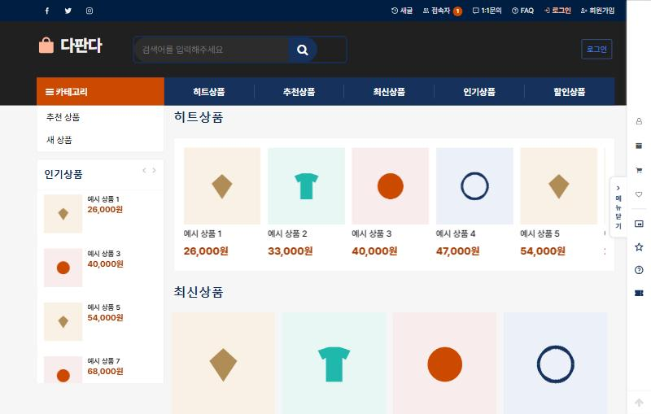
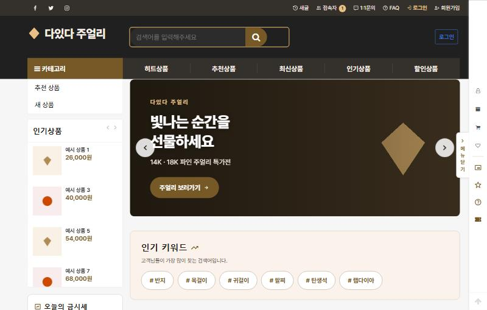
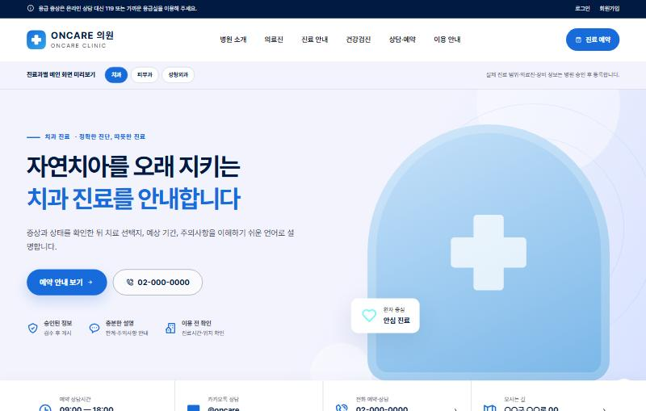
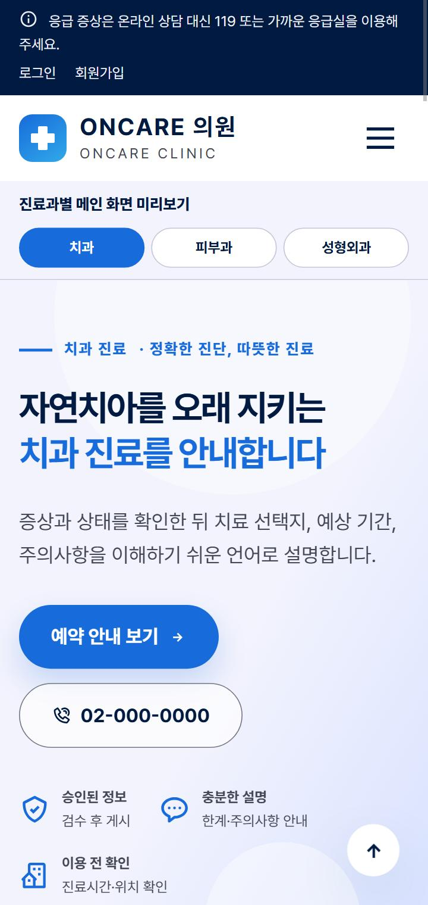

# 그누보드5 M3 테마 3종

그누보드5(영카트 포함)용 테마 3개입니다. **Material Design 3(M3)** 의 색·글자·모서리 규칙을 CSS 토큰으로 옮겨 만들었고, 글꼴과 아이콘을 테마 안에 담아 **외부 CDN 없이** 동작합니다.

| 테마 | 폴더 | 용도 | 대표색 |
|---|---|---|---|
| 다판다 | `themes/dapanda` | 50~60대 고객용 종합 쇼핑몰 | 남색 `#16325c` + 주황 |
| 다있다 주얼리 | `themes/jewelry` | 주얼리 쇼핑몰 (히어로·인기 키워드·금시세·귀금속 색 미리보기) | 골드 `#b08d57` |
| ONCARE 의료 | `themes/medical` | 치과·피부과·성형외과 공통 병원 홈페이지 | 파랑 `#176bdb` + 민트 |







> 화면의 상품·배너 그림은 데모용으로 그린 도형입니다.

## 내 PC 에서 바로 보기

PHP 8.0 이상(`mysqli`·`gd` 확장), MySQL 또는 MariaDB, git 이 있으면 됩니다. XAMPP 를 쓰고 있다면 MySQL 만 켜 두면 됩니다.

```bash
git clone https://github.com/lee0508/gnuboard5-m3-themes.git
cd gnuboard5-m3-themes
php demo/setup.php
php -S localhost:8000 -t demo/site
```

브라우저에서 http://localhost:8000 을 엽니다. `demo/setup.php` 는 다음을 한 번에 합니다.

1. 그누보드5 공식 저장소에서 테마를 시험한 커밋(5.6.35 / 영카트 5.4.5.5.1)을 `demo/site` 로 받습니다.
2. 테마 3개를 `demo/site/theme/` 에 복사합니다.
3. DB `gnuboard_m3_demo` 를 만들고 그누보드를 설치합니다. 관리자는 `admin / demo1234!` 입니다.
4. 예시 분류 2개, 예시 상품 8개, 주얼리 배너 3장을 넣습니다.

| 하고 싶은 것 | 명령 |
|---|---|
| 다른 테마 보기 | `php demo/setup.php --theme=jewelry` (`dapanda` · `jewelry` · `medical`) |
| MySQL 비밀번호가 있을 때 | `php demo/setup.php --db-pass=비밀번호` |
| DB 이름·관리자 비밀번호 바꾸기 | `--db-name=이름` `--admin-pass=비밀번호` |
| 처음부터 다시 | `demo/site` 폴더와 DB `gnuboard_m3_demo` 를 지우고 다시 실행 |

`demo/site` 는 git 에 올라가지 않습니다(`.gitignore`).

## 내 그누보드 사이트에 설치하기

1. `themes/` 안의 원하는 폴더를 그누보드의 `theme/` 아래에 복사합니다. 예: `theme/jewelry`
2. 관리자 → 환경설정 → 테마설정에서 **테마적용**을 누릅니다.
3. 쇼핑몰 분류의 스킨 폴더는 `theme/basic` 으로 둡니다(그누보드 규칙상 활성 테마의 `skin/shop/basic` 을 가리킵니다).
4. 주얼리 테마의 히어로 배너는 `data/common/hero_1.jpg` ~ `hero_3.jpg` 를 씁니다.
5. 의료 테마의 병원 이름·전화·주소는 `head.php`, `index.php`, `tail.php` 에서 바꿉니다. 예약 버튼은 그누보드 1:1 문의로 연결되어 있습니다.

## 디자인 시스템

라이브러리(`@material/web` 등)는 쓰지 않습니다. 공식 웹 라이브러리가 유지 보수 모드이고 CDN 의존이 생기기 때문입니다. 대신 **M3 토큰 이름을 그대로** CSS 변수로 씁니다.

```
themes/<테마>/css/
├── m3-tokens.css             색·글꼴·글자 크기·모서리 토큰 (--md-sys-*)
├── fonts/PretendardVariable.woff2
└── icons/boxicons-local.css  Boxicons v3 를 CSS mask 로 그린 아이콘
```

- **색**: 대표색을 [Material Color Utilities](https://github.com/material-foundation/material-color-utilities) 의 `SchemeFidelity`(라이트)로 변환했습니다. 대표색은 `--md-sys-color-primary-container` 에 그대로 남습니다. 테마 CSS 에는 hex 대신 `var(--md-sys-color-*)` 만 씁니다. 대표색을 바꾸려면 [Material Theme Builder](https://material-foundation.github.io/material-theme-builder/) 로 새 값을 만들어 `m3-tokens.css` 만 바꾸면 됩니다.
- **글꼴**: Pretendard 하나로 한글·영문을 모두 씁니다.
- **아이콘**: 마크업은 그누보드에서 익숙한 `<i class="bx bx-이름">` 그대로 쓰고, 모양만 Boxicons v3 로 그립니다. 새 아이콘은 `tools/build-boxicons.cjs` 대응표에 더하고 다시 생성합니다.
- **접근성**: 글자 대비 4.5:1 이상, 가장 작은 글자 12px, 누르는 영역 48px(최소 40px). 그누보드 기본 상품 스킨의 대비가 낮은 배지·회색 글자도 테마에서 덮어씁니다.

## 라이선스

- 테마 코드: SIR 베이직 테마를 바탕으로 만들었으므로 그누보드와 같은 **GNU LGPL 2.1** 입니다. [`LICENSE.txt`](LICENSE.txt)
- 함께 담은 글꼴·아이콘: [`NOTICE.md`](NOTICE.md) (Pretendard — SIL OFL 1.1, Boxicons — MIT)
- Material Design 은 Google 의 디자인 가이드입니다. 이 저장소는 Google 과 관계가 없습니다.

만든 곳: bizaccount (https://bizaccount.co.kr)
